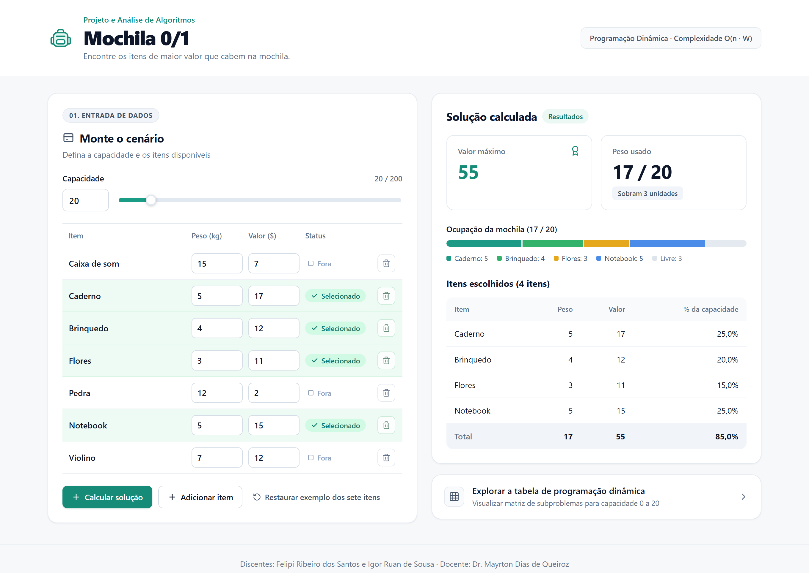
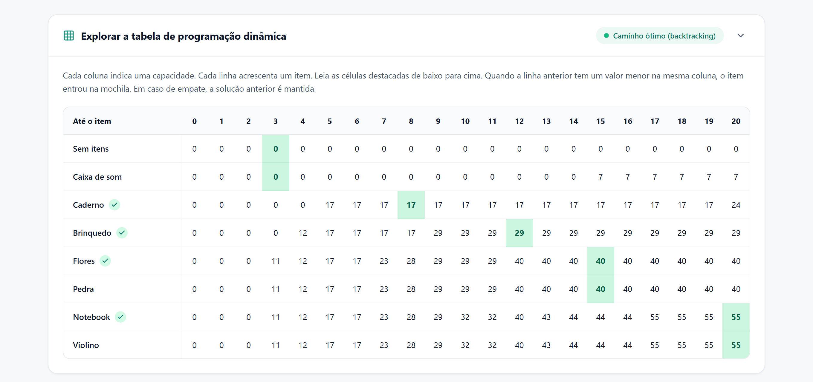
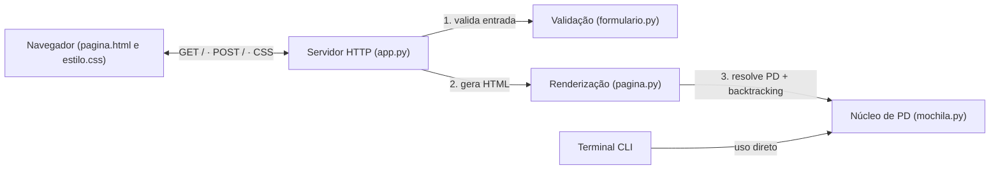

<div align="center">
  
  <h1>Problema da Mochila 0/1 em Python</h1>
  <p>Simulador web interativo e CLI com <strong>Programação Dinâmica</strong> e visualização do <em>backtracking</em>.</p>

  <p>
    
    
    
    
    
  </p>

  <p>
    <a href="#visão-geral-da-interface">Interface</a> ·
    <a href="#arquitetura-do-sistema">Arquitetura</a> ·
    <a href="#como-executar">Como executar</a> ·
    <a href="#exemplo-passo-a-passo-capacidade-5">Algoritmo</a> ·
    <a href="#testes-automatizados">Testes</a>
  </p>
</div>

---

Quais itens vale a pena levar quando a mochila tem um limite de peso? Neste projeto, cada item possui um peso e um valor, e o sistema encontra uma combinação com o **maior valor total possível** dentro da capacidade informada usando **programação dinâmica**. O nome **0/1** representa as duas escolhas para cada item: deixá-lo de fora (`0`) ou levá-lo inteiro uma única vez (`1`).

## Contexto acadêmico

Projeto desenvolvido para a disciplina de **Projeto e Análise de Algoritmos (PAA)**, com o objetivo de aplicar programação dinâmica a um problema clássico de otimização, visualizar a matriz de subproblemas com reconstrução da solução ótima (*backtracking*) e analisar a complexidade de tempo e memória.

- **Discentes:** Felipi Ribeiro dos Santos e Igor Ruan de Sousa
- **Docente:** Dr. Mayrton Dias de Queiroz

## Visão geral da interface

### Tela principal — Montagem do cenário e solução ótima

<p align="center">
  
</p>

A tela principal é organizada em dois painéis sincronizados:

- **Monte o cenário (esquerda):** permite ajustar a capacidade da mochila de `0` a `200` via campo numérico ou controle deslizante, editar nomes, pesos e valores, adicionar até `50` itens, remover linhas ou restaurar o cenário padrão de 7 itens. Os itens escolhidos na solução ótima recebem destaque visual em verde e o selo **Selecionado**.
- **Solução calculada (direita):** apresenta o **valor máximo** alcançado, o **peso usado** com o saldo livre de capacidade, uma **barra segmentada proporcional** identificando quanto cada item escolhido ocupa na mochila e a tabela detalhada dos itens selecionados com a coluna **% da capacidade** e a linha **Total**.

### Tabela de programação dinâmica e *backtracking*

<p align="center">
  
</p>

Ao clicar em **Explorar a tabela de programação dinâmica**, o painel expande em largura total exibindo a matriz de subproblemas `(n + 1) × (W + 1)`:

- Cada **coluna** representa uma capacidade parcial (de `0` até `W`) e cada **linha** considera mais um item disponível.
- As células destacadas em verde indicam o **caminho ótimo percorrido de baixo para cima** durante o *backtracking*, permitindo acompanhar visualmente quando o valor cresce em relação à linha anterior (item incluído) ou empata (solução anterior mantida).
- Os itens que efetivamente entraram na mochila recebem um indicador circular verde ao lado do nome na coluna fixa **Até o item**.

## Arquitetura do sistema

O sistema segue uma arquitetura em camadas leves usando apenas a **biblioteca padrão do Python**, separando servidor HTTP, validação de entrada, renderização de template e núcleo algorítmico (sem duplicação da lógica de *backtracking*):



### Fluxo de uma requisição (`POST /`)

1. O usuário altera a capacidade ou os itens e aciona **Calcular solução**, **Adicionar item** ou **Remover** em [pagina.html](./pagina.html) (enviado via `fetch` assíncrono, com fallback nativo de formulário).
2. [app.py](./app.py) recebe o `POST /`, decodifica os campos UTF-8 e delega a validação para `ler_formulario` em [formulario.py](./formulario.py), retornando `400` com mensagem descritiva caso algum limite seja violado.
3. [pagina.py](./pagina.py) invoca `resolver_mochila_detalhada` em [mochila.py](./mochila.py), que calcula a tabela de PD e executa o *backtracking* uma única vez, devolvendo `SolucaoMochila`.
4. [pagina.py](./pagina.py) preenche o template [pagina.html](./pagina.html) (em cache por `mtime`), retorna o HTML pronto e a interface atualiza apenas a área principal mantendo fluidez e o estado da tabela de PD.

## Tecnologias utilizadas

- **Python 3.8+** — Algoritmo de programação dinâmica (`mochila.py`), validação tipada, testes (`unittest`) e servidor HTTP usando apenas a biblioteca padrão (`http.server`, `argparse`, `typing`, `string.Template`).
- **HTML5** — Estrutura semântica da interface web, formulários e acessibilidade.
- **CSS3** — Identidade visual clara, layout responsivo, barra de ocupação segmentada e cabeçalho/coluna fixos (`sticky`) na matriz de PD.
- **JavaScript** — Sincronização do controle deslizante (`0` a `200`), expansão da tabela de PD e atualização assíncrona via `fetch`.
- **Git** — Controle de versão do projeto.

## Como executar

O projeto usa **apenas a biblioteca padrão do Python** (Python 3.8 ou superior), sem dependências externas.

### 1. Simulador Web (recomendado)

Abra a pasta do projeto no terminal ou no VS Code e execute:

```bash
python app.py
```

Em sistemas que usam `py` (Windows) ou `python3` (Linux/macOS):

```bash
py app.py
# ou
python3 app.py
```

Depois abra **http://127.0.0.1:8000** no navegador (se a porta `8000` já estiver em uso, o servidor escolhe automaticamente a próxima porta livre e exibe o endereço no terminal; você também pode informar outra porta com `python app.py --porta 8080`). Para encerrar o servidor, pressione `Ctrl+C`.

### 2. Interface de Terminal (CLI)

A versão em linha de comando continua disponível em [mochila.py](./mochila.py):

```bash
python mochila.py --exemplo --tabela
```

Para informar seus próprios dados no terminal:

```bash
python mochila.py
```

**No Google Colab**, abra um notebook, envie `mochila.py` pelo painel **Arquivos** e execute em uma célula:

```python
%run mochila.py --exemplo --tabela
```

## Estrutura do projeto

- [app.py](./app.py) — Servidor HTTP local com porta exclusiva (`SO_EXCLUSIVEADDRUSE`), fallback automático de porta, `--porta` e cache de CSS em memória por `mtime`.
- [mochila.py](./mochila.py) — Algoritmo de programação dinâmica (`resolver_mochila` e `resolver_mochila_detalhada`), `SolucaoMochila` com *backtracking* centralizado e interface CLI.
- [formulario.py](./formulario.py) — Validação tipada de entrada com mensagens descritivas e ações de adicionar/remover itens.
- [pagina.py](./pagina.py) — Montagem dinâmica da página, cache do template por `mtime`, barra segmentada de ocupação, tabela de resultados e matriz de PD.
- [pagina.html](./pagina.html) — Estrutura HTML da interface web e interações do slider (`0` a `200`), tabela de PD e `fetch`.
- [estilo.css](./estilo.css) — Identidade visual, responsividade e bloqueio de inversão forçada de cores.
- [tests/test_mochila.py](./tests/test_mochila.py) — Suíte de 13 testes automatizados com `unittest` (biblioteca padrão).
- [assets/](./assets/) — Logotipo vetorial ([logo.svg](./assets/logo.svg)) e capturas da interface ([interface-principal.png](./assets/interface-principal.png) e [tabela-pd.png](./assets/tabela-pd.png)).

## Testes automatizados

Para executar toda a suíte de testes (algoritmo, empates, peso zero, validação do formulário, renderização HTML e rotas HTTP):

```bash
python -m unittest discover -s tests -v
```

## Exemplo passo a passo (capacidade 5)

| Item | Peso | Valor |
| --- | ---: | ---: |
| A | 1 | 6 |
| B | 2 | 10 |
| C | 3 | 12 |

Escolher primeiro o item com maior razão valor/peso levaria a `A` e depois a `B`, somando `16` e deixando apenas `2` unidades livres (insuficientes para `C`). A combinação ótima é **B + C**, com valor total **22**:

| Itens disponíveis / limite de peso | 0 | 1 | 2 | 3 | 4 | 5 |
| --- | ---: | ---: | ---: | ---: | ---: | ---: |
| Sem itens | 0 | 0 | 0 | 0 | 0 | 0 |
| A | 0 | 6 | 6 | 6 | 6 | 6 |
| A, B | 0 | 6 | 10 | 16 | 16 | 16 |
| A, B, C | 0 | 6 | 10 | 16 | 18 | **22** |

Na última célula (capacidade `5`, avaliando `C`):
- **Deixar `C` de fora:** mantém o melhor valor da linha anterior para limite `5`, que é **16**.
- **Levar `C`:** soma o valor `12` ao melhor valor da linha anterior para a capacidade restante `5 - 3 = 2` (`10`), resultando em **12 + 10 = 22**.

Na reconstrução (*backtracking*), percorrendo a tabela de baixo para cima: a melhora de `16` para `22` indica que `C` entrou; descontando seu peso (`3`), na coluna `2` o aumento de `6` para `10` indica que `B` também entrou. Em caso de empate, a solução da linha anterior é mantida.

## Complexidade

Para `n` itens e capacidade inteira `W`:
- **Tempo:** $O(n \cdot W)$ para preencher a tabela de `(n + 1) × (W + 1)` células e $O(n)$ para reconstruir os itens escolhidos.
- **Espaço:** $O(n \cdot W)$ para armazenar a tabela de subproblemas usada na visualização e no *backtracking*.
- O algoritmo tem complexidade **pseudopolinomial**, pois depende do valor numérico da capacidade `W`.
